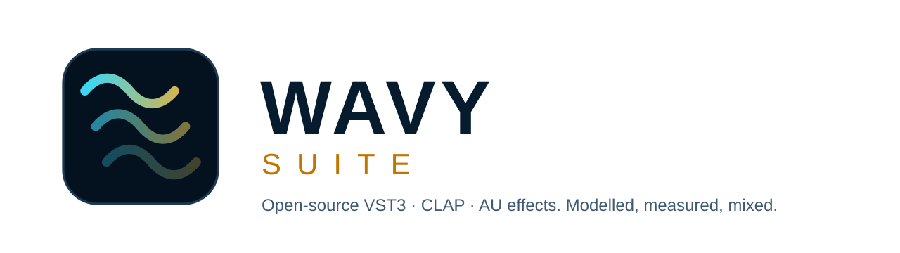
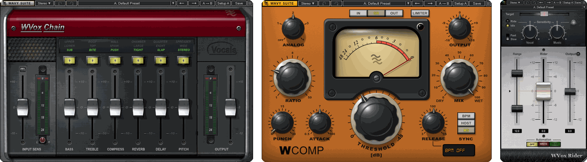
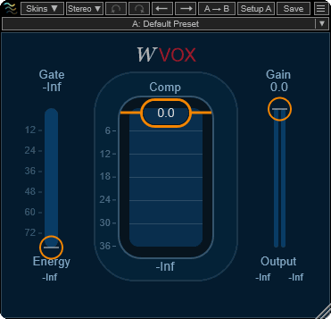
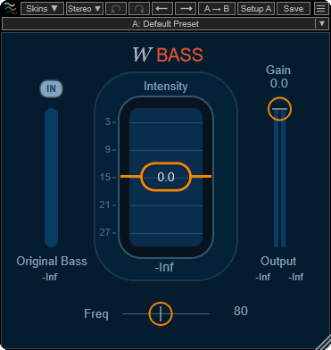
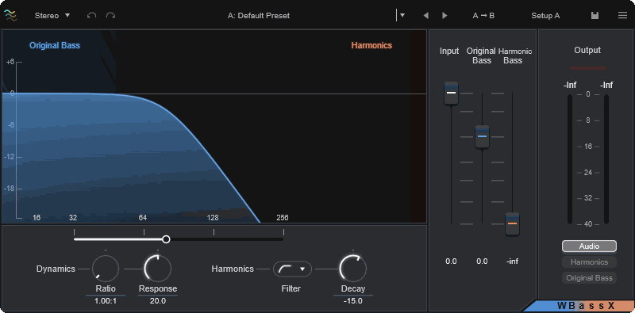
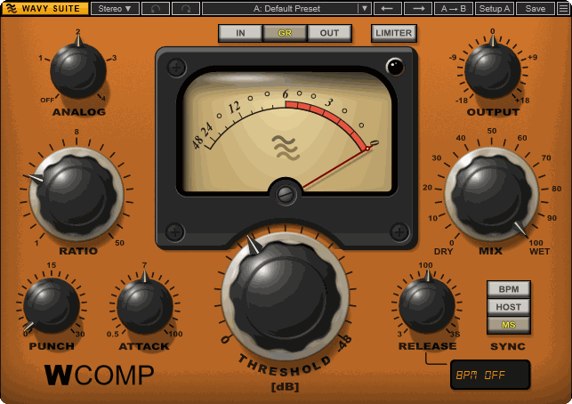
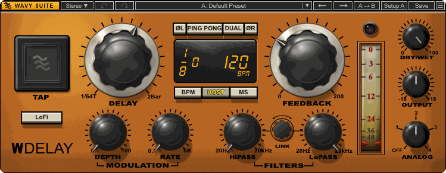
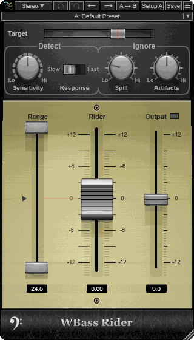
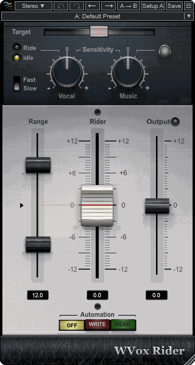
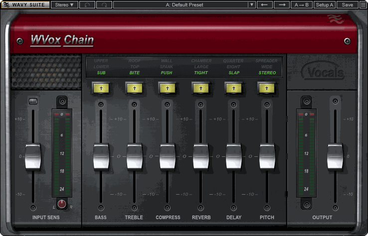

<p align="center">
  <picture>
    <source media="(prefers-color-scheme: dark)" srcset="docs/branding/wavy-banner-dark.svg">
    
  </picture>
</p>

# Wavy Suite

Open-source mixing plug-ins (VST3, CLAP, AU) for Windows, macOS and Linux, each one a from-scratch recreation of a
familiar studio tool, measured and null-tested against the original.

[](LICENSE)
[](#build-from-source)
[](#build-from-source)

<p align="center">
  
</p>

> Wavy Suite is an independent project. It is not affiliated with, endorsed by or sponsored by Waves Audio.
> Other companies' product names appear only to describe what a Wavy plug-in is modelled on and belong to their owners.

## Features

- **Modelled from measurements.** Each plug-in's behaviour was identified from the original's manual and from thousands
  of test renders, then null-tested. The results are published as measured, weak cases included
  ([docs/RESULTS.md](docs/RESULTS.md)).
- **One plug-in per tool.** Mono and stereo variants live in one plug-in behind a **Mode** switch.
- **The same toolbar everywhere:** undo and redo, a preset menu with factory presets (Wavy names) and your own, A/B
  setups with copy, and a window-size menu.
- **Every format from one build:** VST3 and CLAP on all three systems, plus AU on macOS.

## Plug-ins

| | Plug-in | Modelled on | Match (median residual) |
|---|---|---|---|
|  | **WVox** | three-control vocal compressor, gate and limiter | −70 dB over a 672-case grid; steady tones null |
|  | **WBass** | psychoacoustic bass enhancer | −36.8 dB |
|  | **WBassX** | bass enhancer with harmonics compressor, filters and monitor modes | −48.5 dB |
|  | **WComp** | hybrid compressor with punch, tempo-synced release, analog modes and limiter | −47.0 dB |
|  | **WDelay** | hybrid delay with tape-style time changes, ping-pong, modulation, filters and LoFi | delay path −84 to −104 dB |
|  | **WBass Rider** | note-by-note bass level rider | bass line −30 dB |
|  | **WVox Rider** | real-time vocal level rider | vocals −47 to −74 dB |
|  | **WVox Chain** | one-fader-per-stage vocal chain: EQ, compression, de-essing, reverb, delay, doubling | in development; −30.8 dB without the doubler |

Lower is better: about −60 dB or less is a close match, 0 dB is no match. Per-setting numbers, weak spots and how
each model was found: [docs/RESULTS.md](docs/RESULTS.md).

WVox Chain is not in the installers yet. WVox Bend is planned.

## Install

No installer has been published on this repository's
[Releases](https://github.com/MaymiPR/Wavy-Suite/releases) page yet. When one is, there is one installer per system,
each with every plug-in:

| System | File | Installs to |
|---|---|---|
| Windows 10 / 11 (64-bit) | `WavySuite-<version>-Windows-Setup.exe` | `Common Files\VST3\Wavy Suite`, `Common Files\CLAP\Wavy Suite` |
| macOS 10.13+ (Apple Silicon and Intel) | `WavySuite-<version>-macOS.pkg` | `/Library/Audio/Plug-Ins/{Components, VST3/Wavy Suite, CLAP/Wavy Suite}` |
| Linux x86-64 (glibc 2.35+) | `WavySuite-<version>-Linux.tar.gz` | `~/.vst3/Wavy Suite`, `~/.clap/Wavy Suite` (run `install-linux.sh`) |

The installers are not code-signed or notarized. First-run steps for each system are in [packaging/](packaging).

## Build from source

You need CMake 3.22 or newer, Git and a C++17 compiler (Visual Studio on Windows, Xcode on macOS, GCC on Linux).
CMake downloads JUCE and the CLAP extensions on the first configure.

```bash
cmake -S . -B build
cmake --build build --config Release
ctest --test-dir build -C Release
```

The plug-ins land in `build/plugins/<Name>/<Name>_artefacts/Release/` (`VST3/`, `CLAP/`, and `AU/` on macOS). Copy them
to your system's plug-in folder (see the table above) and rescan in your DAW.

On Linux, install the JUCE dependencies first (the list the release build uses, Ubuntu 22.04):

```bash
sudo apt-get install ninja-build libasound2-dev libjack-jackd2-dev libfreetype-dev libfontconfig1-dev \
  libx11-dev libxcomposite-dev libxcursor-dev libxext-dev libxinerama-dev libxrandr-dev libxrender-dev \
  libglu1-mesa-dev mesa-common-dev
```

On Windows, clone to a short path or enable `git config --global core.longpaths true`: some JUCE example files have long
names.

## Usage

Insert any Wavy plug-in on a track in a VST3, CLAP or AU host. Every editor opens with the same toolbar:


| Control | What it does |
|---|---|
| Logo | About, the GitHub page, Report an Issue, License |
| Mode (Stereo ▼) | Picks the variant, such as Mono or Stereo |
| ↶ ↷ | Undo and redo |
| Preset box | Default Preset, factory presets, your saved presets, Save As, Show User Presets Folder |
| ← → | Previous and next preset |
| A → B, Setup A / B | Copy the current setup to the other slot; switch between the two |
| Save | Saves the current preset (asks for a name the first time) |
| ☰ | Window size (as a percentage), Apply as Default to All |

## Documentation

- [docs/RESULTS.md](docs/RESULTS.md): null-test results per plug-in
- [RESEARCH.md](RESEARCH.md): documented behaviour of the originals
- [MEASUREMENTS.md](MEASUREMENTS.md): what was measured and identified, and how (data in `measurements/`)
- [docs/VALIDATION.md](docs/VALIDATION.md): unit tests, pluginval and CI
- [docs/IMPROVEMENTS.md](docs/IMPROVEMENTS.md): open items per plug-in
- [CHANGELOG.md](CHANGELOG.md)

## Contributing

Bug reports and pull requests are welcome on [GitHub](https://github.com/MaymiPR/Wavy-Suite/issues). Run `ctest` before
opening a pull request. The installers are built by [release.yml](.github/workflows/release.yml), which runs on a
`v<version>` tag or by hand. To add a plug-in to them, list it in [packaging/plugins.txt](packaging/plugins.txt).

## License

[AGPL-3.0](LICENSE). The reference plug-ins and their artwork are not part of this repository.
